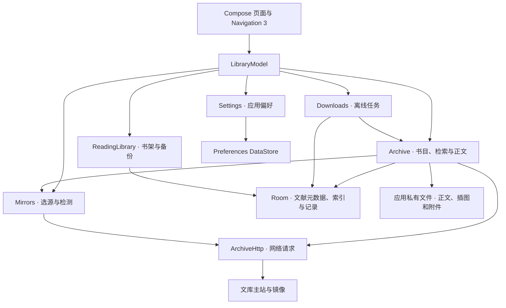

<p align="center">
  
</p>

<h1 align="center">中文马克思主义文库</h1>

<p align="center">独立维护的原生 Android 阅读客户端，支持 HTML、PDF 和 EPUB。</p>

应用内置基础书目，首次启动即可浏览。联网后可同步目录并从文库主站或镜像打开正文，也可按章或整册下载。收藏、书签、笔记和阅读进度保存在设备上。 [中文马克思主义文库](https://www.marxists.org/chinese/)

[功能与使用](#功能与使用) · [构建与安装](#构建与安装) · [技术栈](#技术栈) · [项目架构](#项目架构) · [目录结构](#目录结构) · [测试与贡献](#测试与贡献) · [内容来源与许可](#内容来源与许可) · [免责声明](#免责声明)

## 功能与使用

| 功能 | 支持内容 |
| --- | --- |
| 文库与搜索 | 按作者、文集和专题浏览，支持目录同步、站方 RSS 更新、简繁书目通搜，以及从 Android 分享菜单打开文库链接。 |
| 内容来源 | 自动选源、手动切换和添加自定义 HTTPS 镜像。检测结果用图标、颜色和文字区分可用、响应较慢、超时和样本缺失等状态。 |
| HTML 与 EPUB | 调整字号、行距、段距、首行缩进和主题。阅读器支持章节目录和篇内查找，识别到原文脚注时可预览、跳到注释再返回原注号。 |
| PDF | 纵向连续阅读或横向滑动翻页，可选滑动、淡入和无动画。支持缩放、跳页、目录及阅读进度恢复。选字、复制与搜索依赖原文件的文字层。 |
| 下载与离线 | 支持选章或整册下载、仅 Wi-Fi、暂停、继续、取消和重试。已下载的 HTML 正文可离线搜索，结果可跳到匹配段落。 |
| 书架与朗读 | 收藏、书签、最近阅读、高亮和批注，支持书架备份与 Markdown 笔记导出。文本朗读使用设备的中文语音，引擎提供本地语音时可离线使用。 |

### 常用操作

1. 在「文库」同步目录，或在「搜索」输入作品名和作者。要查已下载的 HTML 正文，可切换到离线正文搜索。
2. 在「设置 → 内容来源」检测单个镜像或选择「检测全部」。检测耗时包含站点首页和样本文献两次读取。成功但达到 2.5 秒时显示「响应较慢」。自动模式优先主站，超时或缺页时会尝试其他来源。
3. 在有章节目录的文集页选择「下载全部」或「下载所选」，再到「书架 → 下载」查看任务。读取附件时会显示连接、传输和校验等阶段，已知大小的文件会显示传输百分比。
4. PDF 的「阅读设置」可切换排列方式和翻页动画。增强模式渲染异常时，可重试或切换到「基础阅读」，两种模式共用页码。在带目录的 PDF 里可直接跳转，也可以点击底部页码输入目标页。
5. 在「设置 → 备份与导出」导出 JSON 书架备份。导入会合并收藏、书签及其高亮与批注、阅读进度，同一条记录保留较新的内容。下载文件和偏好另存于应用本地，书架备份的范围限于阅读记录。
6. 在「设置 → 关于」可离线查看项目许可证和免责声明，也可打开项目主页及文库站方条款。
7. 在「设置 → 关于 → 检查应用更新」查看 GitHub 最新正式发布。有新版时，可下载后由 Android 确认安装，也可打开 GitHub 发布页。

## 构建与安装

应用最低支持 **Android 8.0（API 26）**，编译与目标 SDK 均为 37。准备 Android SDK Platform 37、Build Tools 37.0.0 与 JDK 17 或兼容的更高版本。使用 Android Studio 时，选择支持 AGP 9.5 的版本，打开项目根目录并等待 Gradle 同步，然后运行 `app`。命令行构建可通过 `local.properties` 中的 `sdk.dir` 指定本机 SDK。 [应用构建配置](app/build.gradle.kts)

项目自带 Gradle 9.6.0 Wrapper。首次构建需下载 Gradle 和依赖。在项目根目录执行以下命令，可同时生成调试 APK、运行本地单元测试并生成 Lint 报告。 [Gradle Wrapper 配置](gradle/wrapper/gradle-wrapper.properties)

**Windows**

```powershell
.\gradlew.bat :app:assembleDebug :app:testDebugUnitTest :app:lintDebug
```

**macOS / Linux**

```sh
./gradlew :app:assembleDebug :app:testDebugUnitTest :app:lintDebug
```

调试 APK 位于 `app/build/outputs/apk/debug/app-debug.apk`，包名为 `app.marxistlibrary.reader.debug`，可以和包名为 `app.marxistlibrary.reader` 的正式版并存。连接启用了 USB 调试的设备或启动模拟器后，也可用 `adb install -r app/build/outputs/apk/debug/app-debug.apk` 安装。

正式构建使用 `:app:assembleRelease` 生成 APK、`:app:bundleRelease` 生成 AAB。Release 启用了 R8 代码优化和资源压缩，分发前需使用自己的发布密钥签名。 [Release 构建配置](app/build.gradle.kts)

### 通过 GitHub 发布应用更新

在 GitHub 新建正式 Release，标签使用与 `versionName` 对应的版本号，例如 `v1.1.6`。上传签名后的通用 APK，推荐命名为 `MarxistLibrary-1.1.6.apk`。只有一个 APK 时也可使用其他文件名。后续 APK 使用同一发布密钥签名，`versionCode` 随更新递增。 [项目发布页](https://github.com/Qiuerjun/marxist-library-android/releases)

应用手动检查最新正式 Release。下载后校验大小、包名、版本和签名，有 GitHub SHA-256 时也会核验摘要。首次通过客户端安装时，Android 可能要求允许此应用安装，返回后由用户确认安装。发布页可在下载或安装不可用时打开。

## 技术栈

| 领域 | 组件 | 项目中的用途 |
| --- | --- | --- |
| 构建 | Kotlin 2.4.10、AGP 9.5.0、Gradle 9.6.0、KSP | 构建单个 Android 应用模块，生成 Room 数据访问代码。 |
| 界面与导航 | Jetpack Compose、Material 3、Navigation 3 | 原生页面、阅读工具栏、设置弹窗以及文献和下载页面的路由。 |
| 状态与异步 | AndroidX Lifecycle、ViewModel、Kotlin 协程与 Flow | 跟踪页面生命周期，将书架、偏好、镜像检测和下载状态呈现到界面。 |
| 文库访问 | OkHttp、Jsoup | 访问主站与镜像、校验响应、解析旧网页目录、正文和脚注。 |
| 本地数据与搜索 | Room 2.8.5、SQLite FTS4、Preferences DataStore、OpenCC 词表 | 持久化书目和阅读记录，索引已下载段落，保存偏好，完成简繁检索归一化。 |
| 阅读器 | AndroidX WebKit、PDF.js 6.5.438、Android `PdfRenderer` | 在本地 WebView 排版正文和渲染增强 PDF，提供原生基础 PDF 阅读。 |
| 后台任务 | WorkManager、Android `JobScheduler` | 后台下载、重试与站方 RSS 刷新，调度符合条件的用户发起大文件下载。 |
| 备份与导出 | kotlinx.serialization、系统文件选择器 | 读写 JSON 书架备份，保存 Markdown 笔记。 |
| 测试与检查 | JUnit 4、Android Lint | 运行 JVM 单元测试与静态检查。 |

依赖版本以 Gradle 版本目录为准。PDF.js 及其中文字符映射、字体和解码资源随应用打包。 [依赖版本目录](gradle/libs.versions.toml) · [PDF.js 打包说明](app/src/main/assets/pdf/vendor/VERSION.txt)

## 项目架构

工程包含一个 `:app` 模块，按书目、来源、阅读、下载、搜索、书架、设置和应用更新划分代码。`LibraryApp` 创建应用级服务，`MainActivity` 管理页面路由，`LibraryModel` 为各页面提供服务入口和操作反馈。 [应用入口](app/src/main/java/app/marxistlibrary/reader/MainActivity.kt) · [服务装配](app/src/main/java/app/marxistlibrary/reader/LibraryApp.kt)



### 目录结构

```text
.                                                   # 项目根目录
├── app/                                            # Android 应用模块
│   ├── build.gradle.kts                            # 应用的 SDK、依赖及调试和发布构建配置
│   ├── schemas/                                    # Room 导出的数据库结构快照
│   └── src/                                        # 应用与测试的源码目录
│       ├── main/                                   # 应用主程序和打包资源
│       │   ├── AndroidManifest.xml                 # 声明应用组件、权限和应用属性
│       │   ├── java/app/marxistlibrary/reader/     # 应用 Kotlin 源码的根包
│       │   │   ├── MainActivity.kt                 # 主页面导航和分享链接入口
│       │   │   ├── LibraryApp.kt                   # 初始化应用服务，定义 LibraryModel
│       │   │   ├── LibraryDatabase.kt              # Room 表结构、DAO 和数据库声明
│       │   │   ├── catalog/                        # 同步书目、解析网页和管理文献缓存
│       │   │   ├── download/                       # 调度离线下载，跟踪进度和重试
│       │   │   ├── library/                        # 管理收藏、书签、阅读进度和备份
│       │   │   ├── reader/                         # HTML、PDF、EPUB 阅读器与系统朗读
│       │   │   ├── search/                         # 简繁归一化和中文检索词处理
│       │   │   ├── settings/                       # 读写主题、排版和网络等偏好
│       │   │   ├── sources/                        # 文库链接处理、镜像检测和网络请求
│       │   │   ├── ui/                             # 文库、搜索、书架和设置等 Compose 页面
│       │   │   └── update/                         # GitHub 应用更新、APK 校验和安装
│       │   ├── assets/                             # 随 APK 打包的书目、词表和 WebView 资源
│       │   │   ├── catalog.tsv                     # 首次启动可用的基础书目
│       │   │   ├── chinese-variants.tsv            # 简繁检索归一化词表
│       │   │   ├── opencc-license.txt              # OpenCC 词表的许可文本
│       │   │   ├── reader.css                      # 文本阅读器的排版、主题和注释样式
│       │   │   ├── reader.js                       # 文本检索、选区高亮和阅读定位
│       │   │   ├── reader-layout.js                # 整理旧网页的换行、段落与阅读锚点
│       │   │   ├── reader-notes.js                 # 识别原文注号并生成脚注预览
│       │   │   └── pdf/                            # 增强 PDF 阅读器的本地资源
│       │   │       ├── index.html                  # 增强 PDF 阅读的 WebView 页面
│       │   │       ├── reader.mjs                  # 初始化 PDF.js，管理翻页、缩放和阅读位置
│       │   │       └── vendor/                     # 随包 PDF.js 及字体、字符映射和解码资源
│       │   └── res/                                # Android 图标、主题、字符串和 XML 配置
│       └── test/java/app/marxistlibrary/reader/    # 应用的 JVM 单元测试源码
│           ├── ArchiveTest.kt                      # 检验链接、正文与脚注解析、搜索和镜像规则
│           ├── ArchiveDownloadTest.kt              # 检验附件断点续传和下载响应校验
│           ├── GitHubReleasesTest.kt               # 检验版本识别、发布资源选择和下载校验
│           └── PdfFileTest.kt                      # 检验 PDF 字节区间读取、位置兼容和进度计算
├── design/                                         # 项目的设计资源
│   └── launcher-icon.png                           # README 展示的应用图标
├── gradle/                                         # Gradle Wrapper 与集中依赖配置
│   ├── libs.versions.toml                          # 集中声明 Gradle 插件和依赖版本
│   └── wrapper/                                    # Wrapper 程序与 Gradle 发行版配置
├── build.gradle.kts                                # 声明项目共用的 Gradle 插件
├── gradle.properties                               # Gradle JVM、并行构建与缓存设置
├── gradlew                                         # macOS / Linux 的 Gradle Wrapper 脚本
├── gradlew.bat                                     # Windows 的 Gradle Wrapper 脚本
├── settings.gradle.kts                             # 定义项目名称、模块和依赖仓库
├── README.md                                       # 项目介绍、使用说明和构建入口
├── LICENSE                                         # 项目自有软件的非商业许可证
├── CHANGELOG.md                                    # 各版本的功能变更与修复记录
├── 开发文档.md                                     # 产品范围、工程设计和实现说明
└── 测试报告.md                                     # 验收环境、样本、结果和测试边界
```

### 文献获取、搜索与缓存

`ArchiveRef` 将文库链接转换成与镜像无关的文献路径和页内锚点。目录、阅读、下载与书架使用同一个路径标识文献，切源后可以沿用阅读记录。`Archive` 在常规打开时优先读取本地副本，需要联网时由 `Mirrors` 提供候选站点，再通过 `ArchiveHttp` 执行请求。自动选源会参考最近的连接失败、缺页和检测结果。 [文献地址](app/src/main/java/app/marxistlibrary/reader/sources/ArchiveRef.kt) · [镜像策略](app/src/main/java/app/marxistlibrary/reader/sources/Mirrors.kt) · [文献仓库](app/src/main/java/app/marxistlibrary/reader/catalog/Archive.kt)

`ArchiveHttp` 将重定向限制在配置的来源范围内。重新请求同一来源的 HTML 时，可通过 `ETag` 或 `Last-Modified` 检查更新，在文献未变更时复用本地副本。 [网络访问规则](app/src/main/java/app/marxistlibrary/reader/sources/ArchiveHttp.kt)

基础书目来自随包的 TSV。同步结果、文献元数据和段落索引保存在 Room，正文、插图和大文件保存在应用私有目录。书目与正文查询先做 Unicode 和简繁归一化。离线正文以已下载 HTML 的段落建立汉字二元组索引，保留原段落定位所需的锚点。 [基础书目](app/src/main/assets/catalog.tsv) · [中文检索](app/src/main/java/app/marxistlibrary/reader/search/ChineseText.kt) · [数据库](app/src/main/java/app/marxistlibrary/reader/LibraryDatabase.kt)

### 阅读与进度恢复

**HTML 与 EPUB** 使用同一套文本阅读组件。`ArchiveMarkup` 从站方网页提取正文和目录，处理旧式中文编码与注释链接，并移除来源网页的脚本。EPUB 从本地包读取章节和目录。排版、脚注交互和章节定位由应用自带的 CSS 与脚本处理，进度依靠段落锚点和上下文定位。 [HTML 解析](app/src/main/java/app/marxistlibrary/reader/catalog/ArchiveMarkup.kt) · [EPUB 解析](app/src/main/java/app/marxistlibrary/reader/reader/EpubBook.kt) · [文本阅读器](app/src/main/java/app/marxistlibrary/reader/reader/ArticleScreen.kt)

**PDF** 增强模式用本地 PDF.js 加载缓存文件的字节区间，支持文字层、手势和目录。目录优先采用 PDF 自带书签，并在条件满足时补充识别原书的印刷目录。原生 `PdfRenderer` 提供基础模式，两个模式共享阅读页码。应用跟踪实际渲染状态，等待异常时提供重试和切换入口。 [PDF 阅读界面](app/src/main/java/app/marxistlibrary/reader/reader/PdfScreen.kt) · [PDF 渲染资源](app/src/main/assets/pdf/)

### 离线任务与本地数据

阅读与下载复用同一文献仓库。下载调度在 Android 14 及以上优先用系统用户发起任务处理符合条件的大任务，其余任务和调度失败的任务由 WorkManager 处理。附件在暂存区写入，服务端支持字节范围请求且文件版本可校验时可续传，续传条件失效时从头获取。缓存清理会保留已有下载仍引用的文献。 [下载调度](app/src/main/java/app/marxistlibrary/reader/download/Downloads.kt) · [文件存储](app/src/main/java/app/marxistlibrary/reader/catalog/ArchiveFiles.kt)

阅读记录和下载状态保存在设备端，镜像选择和阅读偏好保存于 DataStore。文本和 PDF 阅读器使用应用本地资源，站点访问和文献下载由原生网络层完成。启用定时检查时，WorkManager 会在满足网络条件后每天尝试刷新站方 RSS。 [书架与备份](app/src/main/java/app/marxistlibrary/reader/library/ReadingLibrary.kt) · [设置存储](app/src/main/java/app/marxistlibrary/reader/settings/Settings.kt)

### 代码导航

| 位置 | 主要职责或排查入口 |
| --- | --- |
| [`ui/`](app/src/main/java/app/marxistlibrary/reader/ui/) | 文库首页、搜索、文集、书架、镜像和设置界面。 |
| [`catalog/`](app/src/main/java/app/marxistlibrary/reader/catalog/) · [`search/`](app/src/main/java/app/marxistlibrary/reader/search/) | 目录同步、旧网页解析、正文缓存与中文索引。 |
| [`sources/`](app/src/main/java/app/marxistlibrary/reader/sources/) | 链接识别、镜像检测和回退、HTTPS 请求与响应校验。 |
| [`reader/`](app/src/main/java/app/marxistlibrary/reader/reader/) · [`assets/`](app/src/main/assets/) | 原生阅读界面和朗读、正文 CSS 与脚注脚本、PDF 渲染及手势。 |
| [`download/`](app/src/main/java/app/marxistlibrary/reader/download/) | 后台任务启动、网络约束、进度、重试与移除。 |
| [`library/`](app/src/main/java/app/marxistlibrary/reader/library/) · [`settings/`](app/src/main/java/app/marxistlibrary/reader/settings/) | 阅读记录、书架备份和偏好存取。 |
| [`update/`](app/src/main/java/app/marxistlibrary/reader/update/) | GitHub 正式发布查询、下载校验与 Android 安装入口。 |
| [`app/schemas/`](app/schemas/) · [`app/src/test/`](app/src/test/) | Room 导出的结构快照和 JVM 单元测试。 |

## 测试与贡献

`testDebugUnitTest` 覆盖链接归一化、正文与脚注解析、镜像状态、中文检索词、附件续传、PDF 文件区间读取和 GitHub 更新检查。`lintDebug` 运行 Android 静态检查。结果分别位于 `app/build/reports/tests/testDebugUnitTest/index.html` 和 `app/build/reports/lint-results-debug.html`。 [测试源码](app/src/test/)

1.1.3 的验收使用 Android 17 模拟器，另用桌面 Chromium 检查 PDF 交互。真实样本包括《资本论》《共产党宣言》《毛泽东选集》和《列宁全集》的文字版、图像版 PDF，另用合成样本覆盖 EPUB 和网络异常。验收记录列出了 18 项通过的 JVM 测试、Lint 结果、测试书目及设备覆盖范围。 [验收报告](测试报告.md)

欢迎提交 Issue 或 Pull Request。反馈阅读问题时请附上原文链接、章节或页码、App 版本、Android 版本和复现步骤。PDF 问题可补充系统 WebView 版本以及所用的增强或基础模式。镜像或下载问题可补充所选来源、检测状态及网络类型。

修改阅读器时，可用一篇带注释的 HTML、文字版 PDF 和扫描版 PDF 验证排版、导航和恢复进度。修改下载时，可同时检查断网后继续、离线打开和缓存清理。改动 Room 表结构时，请一并检查已有数据库的迁移和导出结构。 [更新日志](CHANGELOG.md) · [开发文档](开发文档.md)

## 内容来源与许可

### 项目许可

本项目**源码公开，限非商业使用**。项目自有代码、有权授权的资源及其在 APK 中的对应部分采用「中文马克思主义文库 Android 客户端非商业软件许可证 1.0」。许可允许非商业使用、修改和无偿分享原版与修改版。再分发须附许可证全文并保留权利声明。收费转售、广告或订阅变现、商业捆绑和经营用途须经相应权利人另行书面授权。 [许可证全文](LICENSE)

### 文库与第三方资源

随包基础书目来自中文马克思主义文库。文献正文按需从所选站点获取，应用保留原文链接。再分发文库材料时，请依据具体版本的权利标注和站方条款确认许可。 [文库首页](https://www.marxists.org/chinese/) · [站方使用条款](https://www.marxists.org/admin/legal/terms-of-use.htm)

随包的 OpenCC 词表、PDF.js 和其他第三方资源适用各自的许可。 [OpenCC 许可](app/src/main/assets/opencc-license.txt) · [PDF.js 许可](app/src/main/assets/pdf/vendor/LICENSE.txt) · [PDF.js 资源声明](app/src/main/assets/pdf/vendor/VERSION.txt)

## 免责声明

本项目是由独立开发者发布和维护的第三方 Android 阅读客户端。文库名称用于标明资料来源。

各站点维护者负责文库原站或镜像的运营，以及站内文献的收录、编辑、发布、更新和下架。文献中的观点与表述归于其署名作者，站点公告与编辑说明归于相应发布者。项目开发者负责客户端的技术实现与维护，包括应用内的来源标注、链接处理和阅读呈现。

正文由所选站点提供，镜像的可用性、收录范围和更新进度取决于对应站点。自动排版、目录和脚注识别的结果可能与原网页或出版物有差异。引用或核对资料时，请查看原文链接及对应出版版本。

软件按现状提供。担保与责任范围以项目许可证第六节和适用法律为准。 [项目许可证](LICENSE)

原站内容的更正或下架请求请联系对应站点。文献的转载授权请向相应权利人确认。 [中文站联络入口](https://www.marxists.org/chinese/) · [文库使用条款](https://www.marxists.org/admin/legal/terms-of-use.htm)

客户端内的来源标注、链接或阅读呈现问题可通过仓库 Issue 反馈，请附上原文链接及涉及的章节或页码。
