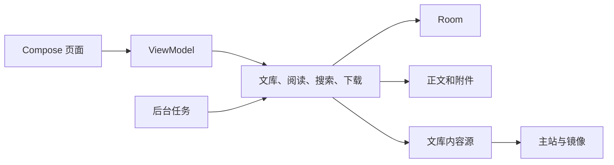

# 中文马克思主义文库 Android 开发文档

**文档版本 v0.1 · 2026-11-23**

本项目是一款面向中文马克思主义文库的第三方 Android 阅读器。读者通过作者、全集、专题或搜索找到文献，在线阅读或下载到设备，随后从书架继续阅读。首版采用原生 Android 界面和离线优先的数据架构，直接访问文库与经过验证的镜像，免登录使用。

## 目录

- [产品范围](#产品范围) · [页面与交互](#页面与交互)
- [技术架构](#技术架构) · [数据模型](#数据模型) · [书目与正文](#书目与正文)
- [镜像选择](#镜像选择) · [阅读定位](#阅读定位) · [中文搜索](#中文搜索) · [下载与存储](#下载与存储)
- [备份与隐私](#备份与隐私) · [测试与验收](#测试与验收) · [构建与发布](#构建与发布) · [开发里程碑](#开发里程碑)

## 产品范围

首版覆盖三个使用场景。读者可以在通勤时离线读书，按作者或关键词查找资料，以及从原文链接进入对应作品并保存章节位置。首页直接列出的作者、合集、专题和词典入口作为首版覆盖基线，每个入口至少可以进入 App 目录或打开对应原网页。已适配的公开 HTML 文献支持在线、下载和离线三种入口。发布记录列出书目快照日期、已适配的目录和页面类型，以及采用原页打开的条目。

| 版本 | 功能范围 | 可以交付的结果 |
| --- | --- | --- |
| 开发原型 | 单篇、分章、分卷、脚注和插图的解析。原生目录、本地阅读、镜像切换和单篇下载 | 可安装 APK。用真实文献演示下载、断网重开、进度恢复和换源 |
| 1.0 | 文库、更新、中文搜索、阅读模式、收藏、书签、最近阅读、分章与整卷下载、镜像管理、备份恢复。PDF 和 EPUB 提供书目、原件下载与系统应用打开 | 在支持的设备上完成找书、阅读、收藏、下载、离线和换机恢复 |
| 1.1 | 高亮批注、笔记导出、系统朗读、内置 PDF 和 EPUB 阅读 | 批注可定位和备份。PDF 可记页码，EPUB 可记章节位置 |
| 后续 | 扫描件 OCR、可选的跨设备同步、在线全文索引 | 根据内容授权、索引覆盖和用户需求单独确定范围 |

源站已经提供作者目录、分卷全集、专题、词典和更新入口。阅读器需覆盖同页分节、跨页章节和卷册嵌套三种常见结构。示例页面用于验证目录层级、注释回链和版本信息。 [文库首页](https://www.marxists.org/chinese/) · [《哥达纲领批判》](https://www.marxists.org/chinese/marx/marxist.org-chinese-marx-1875-4.htm) · [《国家与革命》](https://www.marxists.org/chinese/lenin/191708-09/index.htm) · [《马克思恩格斯全集》文字版](https://www.marxists.org/chinese/marx-engels/index.htm)

## 页面与交互

| 页面 | 主内容 | 关键行为 |
| --- | --- | --- |
| 文库首页 | 继续阅读、最近更新、作者、全集、专题、词典 | 首屏读本地书目。点「继续阅读」直达上次位置。首次使用时用同一区域展示浏览入口 |
| 作者与分类 | 作者列表、作者作品、专题分类、词典条目 | 支持按名称筛选。作者作品按站方目录顺序呈现，可按年代筛选。缺失年份显示为未知 |
| 作品详情 | 标题、作者、写作年代、译者、版本、出处、章节、下载状态 | 首次从开头读，之后可继续。多版本独立选择。分卷作品可下载整卷或选定章节 |
| 搜索 | 全局搜索框、筛选、命中位置和范围 | 可切换书目与本机正文。点击命中片段进入相应段落。从结果返回时恢复筛选和列表位置 |
| 阅读器 | 正文、目录、篇内查找、排版设置、书签、上一章和下一章 | 正文占主要空间。阅读工具可折叠和重新展开。脚注支持查看、跳转和返回。原文入口使用浏览器 |
| 书架 | 收藏、书签、最近阅读、下载 | 区分已下载、部分下载和缓存。长按或菜单可删除、重试、查看存储用量 |
| 下载详情 | 任务队列、完成章节数、大小、失败原因 | 支持暂停、继续、取消、重试失败项和移除下载。通知直达任务详情 |
| 设置 | 镜像、主题、默认阅读设置、网络、存储、备份、关于 | 自动与固定镜像可切换。设置保存后即时生效。关于页提供站方来源、版权、隐私与问题反馈入口 |

手机底部导航只放「文库」「搜索」「书架」，设置从顶栏进入。紧凑窗口使用单栏。达到展开窗口宽度时，目录和作品或正文并排，页内状态跟随窗口变化。Android 返回手势先关闭当前弹层，再返回阅读来源页，并恢复目录的滚动位置。正文宽度随窗口调整，在大屏上限制单行长度。 [Android 窗口尺寸类别](https://developer.android.com/develop/adaptive-apps/guides/use-window-size-classes) · [Edge-to-edge 布局](https://developer.android.com/develop/ui/compose/system/setup-e2e)

### 排版与动效

| 主题 | 背景 | 正文 | 强调色 |
| --- | --- | --- | --- |
| 浅色 | `#FBF8F2` | `#28231E` | `#8B3E36` |
| 暖纸 | `#F2E7D4` | `#3A2D25` | `#7F392E` |
| 深色 | `#1D1A18` | `#E9E0D8` | `#E8A49B` |

- 默认主题跟随系统。界面使用中文黑体，默认阅读字号为 `18sp`，默认行高约 `1.70` 倍。提供字号、行高、页边距与黑体、宋体选择。宋体资源使用可再分发的字库，缺字时由系统中文字体补齐。系统字号与阅读字号分别生效，WebView 只应用一次合成缩放。
- 正文和次级信息保持清楚的字重与对比度。普通文字与底色对比度至少为 `4.5:1`。可点击控件的触控区域至少 `48dp`。图标按钮有 TalkBack 标签，目录与正文保留标题层级，状态配有文字说明。
- 页面和工具面板使用短过渡，初始时长设为 `150–240ms`。系统关闭动画时立即切换。滚动列表按需渲染，长文图片保留尺寸并按需解码。旋转、切换主题和调字号后恢复到同一段落。 [Compose 无障碍默认行为](https://developer.android.com/develop/ui/compose/accessibility/api-defaults)

### 离线与错误状态

| 情况 | 页面反馈与操作 |
| --- | --- |
| 离线首次启动 | 展示随包书目和可离线使用的入口。点击未下载作品时提示连接网络 |
| 刷新更新失败 | 继续显示上次成功的目录和更新时间，允许手动重试 |
| 多个来源缺少当前文献 | 提示「当前来源未找到这篇文献」，提供切换镜像和打开原网页 |
| 正文暂未适配 | 保留书目与来源，提供打开原网页。开发日志记录解析分类 |
| 下载未完成 | 展示已完成的章节及其离线入口。等待网络、暂停和失败分别显示 |
| 附件缺少可打开的系统应用 | 说明文件格式，提供系统文件选择器另存和原网页入口 |

## 技术架构

| 项目 | 基线 |
| --- | --- |
| Android | `minSdk 26`，`compileSdk 37`，`targetSdk 37`。使用支持该 AGP 版本的稳定版 Android Studio |
| 构建 | AGP `9.5.0`、Gradle Wrapper `9.6.0`、JDK `17`。启用 AGP 内置 Kotlin。Compose 编译器与实际 Kotlin 版本对齐，依赖统一锁定在版本目录 |
| 界面 | Jetpack Compose 稳定版 BOM、Material 3、自适应布局、Navigation 3 `1.2.2`。ViewModel 用 `StateFlow` 提供状态，界面按生命周期收集 |
| 存储 | Room `2.8.5` 管理结构化数据及 FTS4 索引。DataStore 保存偏好。正文、图片和原件保存在 App 私有文件目录 |
| 网络与解析 | OkHttp 处理 HTTPS 和条件请求，Jsoup 解析旧式 HTML，XML Pull Parser 读取 RSS。AndroidX WebKit 提供本地 HTML 阅读资源 |
| 后台 | WorkManager 执行目录刷新与可分段的下载。符合条件的长下载在 Android 14 以上使用用户发起的数据传输作业 |

各库采用稳定版。工程初始化时将兼容的 Compose BOM、Room 用 KSP、WorkManager 等版本固定到 `gradle/libs.versions.toml`，通过 Gradle 同步以及 API 26、37 的安装测试验证组合。 [Android 17 SDK](https://developer.android.com/about/versions/17/setup-sdk) · [AGP 9.5 兼容表](https://developer.android.com/build/releases/agp-9-5-0-release-notes) · [内置 Kotlin](https://developer.android.com/build/migrate-to-built-in-kotlin) · [Compose BOM](https://developer.android.com/develop/ui/compose/bom) · [Room](https://developer.android.com/jetpack/androidx/releases/room) · [Navigation 3](https://developer.android.com/jetpack/androidx/releases/navigation3)

界面发送用户动作，ViewModel 调用具体业务并观察结果。Room 提供书目和用户状态的唯一持久来源。正文文件经校验入库后，业务层根据 Room 中的引用读取。同一套内容读取和下载逻辑服务前台与后台。网络请求、HTML 解析、大文本索引和文件操作在后台执行，界面先呈现可用的本地状态。 [Android 架构建议](https://developer.android.com/topic/architecture/recommendations) · [离线优先架构](https://developer.android.com/topic/architecture/data-layer/offline-first)



### 工程组织

初期用一个 `:app` 模块承载功能，另设 `:benchmark` 用于性能测试。代码按业务放置，共用读写规则由数据所有者提供。普通函数和构造注入足以组织首版依赖。新增来源时，目录解析、正文解析和路径映射从同一处接入，目录、搜索及阅读界面复用已有业务入口。

```text
app/src/main/
  java/.../
    catalog/         书目、作者、分类、目录和更新
    reader/          阅读模板、锚点、脚注与阅读设置
    search/          索引、中文词形归一和搜索结果
    library/         收藏、书签、历史与备份
    download/        任务、调度、校验与文件存储
    sources/         主站与镜像、链接映射和站点解析
    settings/        主题、网络、关于和用户设置
  assets/            书目快照、阅读样式与合法可分发资源
app/src/test/        解析样本和业务单元测试
app/src/androidTest/ 设备端数据库与阅读流程测试
benchmark/           Macrobenchmark 与 Baseline Profile
tools/catalog/       生成、校验和比较书目快照
```

网络响应、用户输入、备份文件和本地文件引用在各自的边界校验。内部使用类型明确的作品、章节、来源和任务数据。注释说明版次识别、锚点迁移、下载提交等业务约束，测试样本记录来源、页面类型及预期解析结果。

## 数据模型

| 数据 | 核心字段与约束 |
| --- | --- |
| 作者 `Author` | ID、显示名、别名。作者与作品为多对多关系 |
| 作品 `Work` | ID、书名、文献类型、作者、写作年代。单篇和独立著作都可作为作品 |
| 版本 `Edition` | ID、作品 ID、译者、版本名、出版信息、原文目录链接、权利标记。每种译本与录入版可单独选择 |
| 分类项 `CatalogEntry` | 分类树节点、节点类型、目录顺序、引用目标。同一作品可出现在作者、全集或专题等多处 |
| 章节 `Section` | ID、版本 ID、父章节 ID、标题、顺序、正文页面 ID、起始锚点。卷册和目录节点的正文页面可为空 |
| 页面 `Document` | ID、来源的规范路径、格式、原网页链接。同页的不同锚点共用页面。一个页面可供多个目录节点引用 |
| 正文修订 `ContentRevision` | ID、页面 ID、获取来源、正文摘要、资源清单、校验信息、文件引用、解析器版本、获取时间 |
| 来源 `Source` | ID、显示名、HTTPS 基地址、路径映射、来源类型、是否启用、检测结果与时间。站点状态与单篇可用状态各有记录 |
| 收藏与书签 | 收藏按版本去重。每条书签有独立 ID、版本、章节、阅读锚点、创建与修改时间 |
| 阅读进度 | 每个版本一条最近位置，保存章节、修订、阅读锚点与最后阅读时间。最近阅读按此时间排序 |
| 下载任务与下载项 | 任务包含目标、章节清单快照与状态。下载项保存页面、已确认的内容修订、文件引用、断点、重试次数和失败原因 |

主站路径是页面的规范地址。页面初次登记时用固定命名空间和规范地址生成稳定 ID，构建书目与 App 按同一规则登记。作品、版本及章节由目录分配持久 ID。镜像域名、资源验证器和页内锚点分别记录。规范地址保留参与内容识别的查询参数和路径大小写。`/chinese/`、`/chinese/index.html` 等地址经证实指向同一入口时加入别名表。路径迁移先确认页面和版本对应关系，再把新旧地址映射到同一个 ID。标题相同的记录通过作者、译者、出处和原版目录核对，分别或合并入库。

书目刷新在事务中合并版本与章节。源站撤下的条目标记为来源下线，现有用户记录仍可通过稳定 ID 显示。正文修订和文件引用支持多个下载任务共用同一份文件。索引可从书目及落盘正文重建。数据库版本和书目快照版本分别递增。每次变更持久层时提交 Room schema 与迁移测试，验证旧书签、进度和下载引用。

## 书目与正文

### 书目初始化与更新

1. 由 `tools/catalog` 从维护的源站入口生成版本化书目快照。快照包含快照版本、生成时间、来源路径、作者、分类、版本和章节引用。工具检查重复 ID、引用关系、循环目录、失效链接和新旧条目差异。
2. App 由仓库中的快照构建。首次启动先读随包目录并导入本地索引，导入期间仍可浏览随包的首屏目录。种子包含元数据与原文链接。目录的子层级可按需请求并存入 Room。
3. 最近更新读取站方发布的 `https://www.marxists.org/chinese/feed.xml`。用条目 ID 或规范链接去重，保留站方标题和发布日期。用户可手动刷新，也可开启受联网约束的定时检查，初始间隔为一天。列表显示最近成功同步时间。 [文库 RSS 订阅说明](https://www.marxists.org/chinese/update/rsshelp.htm)
4. 常规请求按来源及 URL 保存 `ETag` 和 `Last-Modified`，有验证器时使用条件请求。`304` 使用对应来源的已校验缓存。超时、无效 XML 或结构异常时保留上一次可用的目录和更新列表。新文章按需取正文。

快照工具针对已定义的书目入口限速执行，遵守站点的抓取规则。历史更新供读者从站方入口打开，RSS 使用站方公开订阅接口。测试和日常 CI 使用固定样本及本地响应。 [站点抓取规则](https://www.marxists.org/robots.txt)

### HTML 解析与内容保存

1. 读取响应头和字节流。按 BOM、可信 HTTP 编码声明、有效 HTML 编码声明尝试解码。对异常页面使用来源已验证的编码规则，覆盖 UTF-8、GB18030 和 Big5。解码异常进入解析失败状态。
2. 识别作者目录、合集、章节目录、HTML 正文或附件。对 HTML 保留标题、作者、版本说明、章节顺序、段落、图注、表格、脚注和原文链接。去掉站方导航、可执行脚本和表单，保留合法的内部跳转。
3. 相对链接按最终的可信页面地址解析。站内链接映射到作品、章节或同页锚点。外链通过用户操作交给浏览器。插图与附件经来源映射、类型及大小校验后保存。
4. 清洗后的正文、目录和资源清单形成可重现的修订。正文内容、资源表和文件摘要采用稳定的序列化规则。预期为正文的页面若返回登录页、拦截页或通用错误页，按来源异常处理。解析规则未覆盖的真实页面保留原文入口与诊断信息。

正文由 App 自己的 HTML 模板排版，通过 `WebViewAssetLoader` 加载受控的本地资源。WebView 的资源请求限于本地阅读地址，远程图片由网络层按规则获取并落盘。模板使用固定内容安全策略，脚本仅用于受控的阅读锚点和排版交互，消息入口限于本地阅读来源及定义好的操作。正文中的导航事件交由 App 路由处理。 [Android WebView 本地内容](https://developer.android.com/develop/ui/views/layout/webapps/load-local-content) · [WebView 文件访问防护](https://developer.android.com/privacy-and-security/risks/webview-unsafe-file-inclusion)

## 镜像选择

主站默认配置为 `https://www.marxists.org`。备用站的候选来自 MIA 镜像列表，发布前检查 HTTPS、中文路径映射及样本正文。站点经手机实际探测后才标为当前网络可用。自定义镜像支持 HTTPS 基地址和可选路径前缀，通过检测后可保存并加入可选来源。列表标明主站、MIA 列出的站点或用户添加的站点。 [MIA 镜像列表](https://www.marxists.org/admin/mirrors/)

### 可用性与新鲜度

| 检测结果 | 判定与展示 |
| --- | --- |
| 可用 | 中文首页和代表性正文均通过轻量 GET 校验，响应类型、正文特征及来源映射符合预期。展示延迟和最近检测时间 |
| 可能较旧 | 首页和样本可读，更新标记早于已知主站检查点。展示可确认的更新日期或范围 |
| 缺少当前文献 | 首页可读，当前路径返回缺页。该结果记在此来源和此页面的组合上 |
| 连接失败 | 区分 DNS、TLS、超时和服务错误。TLS 问题提示检查来源 |
| 响应不符 | 返回非文库网页、重定向目标未获允许，或正文与预期版本相冲突 |
| 待检测 | 新安装、新增站点或当前网络无有效检测。设备离线时单独标示设备状态 |

探测分别检查中文首页和样本文献，每个阶段最多等待 6.5 秒。样本缺失或内容不符时尝试备用样本。界面显示首页响应时间和独立的样本状态。打开作品时仍检查目标内容。镜像可能只同步部分文献，新鲜度以首页标记估算。排序在开始时读取检测结果、近期失败和当前路径的可用性。探测结果按网络环境缓存，自动排序采用 10 分钟内的结果。用户可手动检测全部来源，最多同时检测两站。

### 自动模式与固定模式

1. 已下载内容和可用缓存可以立即阅读。需要联网取正文时，自动模式优先使用近期正常的主站。主站近期连续失败时，优先选择本网络上已验证且内容较新的备用站。
2. 遇到连接超时、临时服务错误、缺页或返回错误页时，自动模式可以尝试下一个已启用来源。每次打开最多尝试 3 个来源，初始总等待上限 16 秒。已有位置和界面继续保留，用户可取消等待。
3. `429` 和带 `Retry-After` 的维护响应按服务端时间退避，避免重复请求。设备断网时进入离线状态。证书异常的来源退出自动候选，按 HTTPS 错误展示。固定模式只访问用户指定的来源，失败页提供检测、切换镜像和打开原页。
4. 入库前检查规范路径、内容类型和已知的版本标记。发现同路径返回另一译本或与已知版本冲突时，提示用户检查来源。整卷任务可以从验证为同一版次的来源补齐未完成章节。打开页面、保存书签和建立任务始终使用规范页面与版本 ID。

## 阅读定位

HTML 章节使用连续滚动。阅读器采用已下载修订直接打开离线条目。在线入口可从本地修订立即展示，并按需检查远程更新。发现内容修订后，当前阅读会话继续使用打开时的版本，用户可主动加载新版。目录、注释和文字选择共享当前章节的内容。

- 位置保存版本 ID、章节 ID、页面 ID、修订 ID、段落锚点、段内偏移和用于重定位的短文本及其上下文。原始段落锚点优先使用，缺少锚点时由解析器生成稳定 ID。段内偏移统一采用 Unicode 码点，WebView 侧转换 DOM 偏移。
- 正文可见位置稳定后节流保存。切章、返回和进入后台时提交最新位置。书签立即写入。保存带会话序号和时间，以最近阅读的有效会话为准。
- 恢复时依次匹配相同修订的锚点、可验证的同名锚点、带上下文的唯一文本匹配，再回到章节开头。降级时提示「已定位到章节开头」。改排版和屏幕尺寸后用锚点恢复位置。查看脚注期间，以进入脚注前的位置作为阅读进度，关闭脚注或点击回链后回到该段落。
- 页面内的锚点由 App 解析。用户分享作品时使用主站规范链接和可识别的原页锚点。App 接收系统分享的文库链接，并提供粘贴地址入口。站外网页交给系统浏览器。
- PDF 与 EPUB 原件在 1.0 中通过临时授权的 `content://` URI 交给系统阅读 App。内置阅读上线后，PDF 保存修订与页码，EPUB 保存修订、章节和锚点。扫描件的全文检索随 OCR 功能交付。

### 阅读增强

1.1 的高亮和笔记使用选区两端的锚点与上下文定位。用户可从书架查看、编辑和导出笔记。内容修订后按阅读定位规则找回选区。无法匹配时，书架显示原笔记及其所在章节。

朗读从当前段落调用系统中文语音，支持暂停、继续、调整语速和跳段。设置中显示语音是否已安装及可离线使用。PDF 按视口渲染页面，提供缩放和页码跳转。EPUB 根据出版物的目录和阅读顺序提供章节导航，正文复用安全的本地阅读模板。

## 中文搜索

书目检索覆盖标题、作者、别名、年代、类别和卷次。正文检索首版覆盖完整下载且已生成索引的 HTML。搜索页显示当前范围和已索引正文的状态。站内在线搜索由单独入口打开。 [文库站内搜索](https://www.marxists.org/chinese/search/index.html)

1. 索引与查询采用同一套可版本化的归一规则，处理全半角、拉丁字母大小写、常用标点及简繁词形。书名、正文和引用展示来源原文。
2. 书目索引对中文单字和相邻双字建立检索词。正文按段落生成相邻双字检索词，使用 Room FTS4 召回候选，再检查实际归一文本和短语顺序。单字正文搜索限定在篇内或用户选定的单部作品，以控制扫描范围。 [Room FTS4 API](https://developer.android.com/reference/androidx/room/Fts4)
3. 默认排序依次为精确书名或别名、书名部分匹配、作者、正文命中。年代和类别过滤作用于所选范围。并列时按目录顺序和稳定 ID 排序。支持「国家」「國家」等双字词及「资本论」「資本論」等简繁查询。
4. 每条正文索引绑定页面修订和段落锚点。下载完成后异步建索引，搜索页说明等待状态。内容移除后清理派生索引。命中高亮用归一前后的偏移映射，返回原始文字。搜索模块用归一后的检索词构造并绑定查询参数，页面取消过期查询并分页加载结果。

## 下载与存储

### 任务与状态

用户可下载单篇、一个或多个章节及整卷。确认任务时固定目录清单，列出待下载章节、已有章节和已知大小。整卷清单包含卷内可阅读节点、关联的正文页面及必要脚注和图片。跳到同一页面不同锚点的章节共用该页面。站外参考文献保留为链接。书目后续新增章节时可以单独补下。

| 状态 | 进入条件 | 可用操作 |
| --- | --- | --- |
| 排队 | 已保存清单，等待调度 | 暂停、取消 |
| 等待网络 | 设备离线或当前网络与设置不符 | 修改下载网络设置、暂停、取消 |
| 下载中 | 正在获取、校验或保存资源 | 查看进度、暂停、取消 |
| 已暂停 | 用户暂停，或系统停止后需要用户继续 | 继续、取消 |
| 部分完成 | 已有可读章节，另有待重试或无法下载的章节 | 阅读已完成章节、重试、查看失败项 |
| 已完成 | 清单内的正文与必要资源全部提交 | 离线阅读、检查更新、移除下载 |
| 失败或已取消 | 遇到明确失败，或用户取消剩余工作 | 查看失败原因、重新发起、移除任务 |

完成度以章节计数为准，字节总量已知时同时显示大小。遇到 404、内容版本冲突、存储不足或格式不支持时写明具体失败项。临时网络错误最多自动重试 3 次，采用指数退避并遵循 `Retry-After`。实际发出且失败的请求才计入重试次数。

### 调度与断点

1. 策略与书目清单落盘后再调度。短任务、目录刷新和可拆分的章节批量下载使用 WorkManager。Android 14 及以上的长下载由用户在 App 可见时发起，满足条件时使用 `JobScheduler` 的用户发起数据传输作业，并提供系统进度通知。较旧系统按章节或小批次提交。 [Android 数据传输任务选择](https://developer.android.com/develop/background-work/background-tasks/data-transfer-options) · [用户发起的数据传输作业](https://developer.android.com/develop/background-work/background-tasks/uidt)
2. 「仅 Wi-Fi」按实际传输网络执行。API 28 及以上可向调度器声明 Wi-Fi 网络约束。旧系统可先等系统的联网调度，再在执行前判定网络。传输使用符合用户设置与系统网络策略的网络，失去该网络时暂停并保存进度。任务页解释等待条件。 [WorkManager 网络约束](https://developer.android.com/reference/androidx/work/Constraints.Builder)
3. 每个任务在 Room 中原子获取执行权。任务暂停、取消或重新排队时更新执行令牌。提交状态时校验令牌，防止旧任务覆盖新状态。同一页面修订的下载或校验结果供多个任务复用。
4. HTML 按页提交，恢复时从未完成的页面继续。大附件按已确认的文件长度和同一资源的强 `ETag` 发送 `Range` 与 `If-Range`，收到匹配的 `206` 和 `Content-Range` 时续写。续传请求遇到 `200`、`416`、验证器变化或范围不符时从头获取附件。缺少强验证器或改用镜像时同样重新下载该附件。 [HTTP 范围请求与 If-Range](https://www.rfc-editor.org/rfc/rfc9110.html#name-if-range)
5. 文件先写到同卷的临时目录，校验响应类型、大小上限及完整性，再原子移动到正式路径。Room 事务提交修订、引用和进度。系统中断后对照任务状态和文件引用，恢复已提交的部分，回收没有引用的临时文件，并把缺失或损坏的内容标为可修复。

书架的「已下载」以实际可读取的离线修订为准。移除下载释放该任务持有的文件引用。阅读缓存按最近访问时间清理，128 MiB 的清理配额统计正文、附件、封面和插图的实际文件大小。多个页面引用的同一文件只计一次，在最后一个引用释放后回收。离线下载由书架单独管理，正在传输的下载也会保护其文件。索引作为派生数据随相应正文回收。

## 备份与隐私

### 备份与恢复

首版导出收藏、书签和阅读进度。通过 Android 存储访问框架，由用户选择 JSON 文件的读写位置。正文、附件和网络缓存由下载功能管理。 [Android 存储访问框架](https://developer.android.com/training/data-storage/shared/documents-files)

1.0 使用 UTF-8 JSON，顶层字段为 `schemaVersion`、`exportedAt`、`favorites`、`bookmarks` 和 `positions`。`schemaVersion` 初始值为 1。后三项为数组，记录版本 ID、规范路径及可重匹配的版本信息。书签与进度记录包含上文定义的阅读位置。时间转换为 UTC 后写入文件。

| 数据 | 恢复规则 |
| --- | --- |
| 收藏 | 按版本合并，同一版本只保留一条 |
| 书签 | 按书签 ID 合并，同 ID 使用最近修改项 |
| 进度 | 同一版本使用较新的最后阅读时间 |
| 暂时无法匹配的文献 | 保存为待匹配条目，显示作品名称和原文入口。同步目录后再次匹配 |

导入前验证格式版本、大小、时间及链接，显示将导入的记录数。确认后在一个事务内合并，出错时回滚事务。重复导入同一个文件应得到相同记录。后续版本可通过格式迁移加入笔记字段。

### 隐私、安全与来源

- 阅读记录和书签保存在本机。书目与下载正文的查询在设备上处理。按系统版本配置备份规则，排除阅读数据及下载文件。App 的内容请求由选定站点接收，关于页说明直接访问源站的行为。 [Android 备份安全](https://developer.android.com/privacy-and-security/risks/backup-best-practices) · [MIA 使用条款与访客隐私](https://www.marxists.org/admin/legal/terms-of-use.htm)
- 网络使用 HTTPS 与 Android 的系统证书验证。用户镜像限定为有效的公共 HTTPS 主机。每次重定向检查协议、主机与已配置的路径范围。源站、镜像、资源和外链按各自的规则处理。正式版只记录必要的错误分类和任务标识。
- HTML、RSS、附件和备份输入设置大小与解码限制。RSS 解析限定为订阅数据并禁用外部实体解析。WebView 以 App 私有资源地址加载阅读内容，关闭通用文件访问和混合内容。附件由 FileProvider 对明确打开的文件提供临时只读授权。
- App 保留作品原文链接、署名、译者、版本及授权说明。个人离线下载按文献的离线限制控制入口。随包分发正文、字库或其他资源前核对对应许可。站点已撤下或停止提供的条目在后续同步时更新状态。关于页说明 App 是第三方客户端。 [MIA 使用条款](https://www.marxists.org/admin/legal/terms-of-use.htm)

## 测试与验收

### 测试分层

| 层次 | 覆盖内容 |
| --- | --- |
| 单元测试 | 规范链接和别名、目录顺序与解析、简繁和短词、阅读位置匹配、镜像选择、下载状态转换、备份合并 |
| 网络集成 | 使用 MockWebServer 模拟 `200`、`206`、`304`、`404`、`429`、超时、重定向和内容不符。覆盖不同编码与不完整响应 |
| 持久化 | Room 迁移、外键和去重、进程中断后的半成品清理、追加章节、共同引用、重复导入 |
| Android 界面 | Compose 流程测试、WebView 锚点和脚注、旋转与折叠、后台返回、系统分享、通知和文件选择器 |
| 真机测试 | 在目标网络上用真机验证镜像。覆盖最低版本、近期 Android 版本及 Android 17，使用中低端手机并验证平板或折叠屏布局 |

解析样本覆盖一页多节、旧编码、分章目录、分卷集合、脚注回链、正文图片、表格和 PDF 附件。开发测试采用可再分发的最小样本或合成响应，保留复现所需结构。站点联通检查单独运行，持续集成中的构建和静态测试使用仓库内的样本。

### 首版验收用例

| 场景 | 通过标准 |
| --- | --- |
| 离线首次打开 | 进入文库首页并浏览随包书目。在线文献展示可理解的联网提示 |
| 下载整卷后断网重开 | 已下章节、文内图片和脚注可打开。重新进入继续阅读时，恢复到已保存的原段落 |
| 下载过程中断网、切换网络或系统回收进程 | 已提交章节可读。任务恢复后继续剩余页面。仅 Wi-Fi 模式在蜂窝网络上暂停 |
| 主站超时或当前文献缺页 | 自动模式在时限内尝试备用。证书错误和明确限流得到对应提示。固定模式保持用户选择 |
| 镜像较旧或路径一致但译本不同 | 显示来源或版本异常。版本与锚点按身份分别管理，完成状态对应经过校验的内容 |
| 原页变动与排版调整 | 同一内容仍定位到同段。锚点失效时可用唯一上下文恢复，必要时回到章首并提示 |
| 中文搜索与范围 | 简繁查询得到同一书目。中文双字词可命中已索引正文。点结果可定位，未索引数据的范围说明准确 |
| 存储不足、取消和重复下载 | 只展示已提交章节，重试可用，文件引用与统计一致 |
| 重复恢复备份和升级 | 重复导入后每条记录只出现一次。旧版收藏、书签和进度在数据库迁移后可打开 |
| 大屏、字号和无障碍 | 分屏、横屏、大系统字体和 TalkBack 下可找书、打开下载及返回正文。系统关闭动画时可以完成同样流程 |

### 性能预算

以下是首轮开发目标。在一台运行 Android 13 或以上、约 4 GB 内存、60 Hz 的中低端真机上，以接近发布的构建测试。使用包含 10,000 条书目与 500 个已下载 HTML 页面的固定数据集，启动场景分别记录首次导入和目录已就绪后的结果。

| 指标 | 初始目标与测量口径 |
| --- | --- |
| 冷启动 | 目录已导入时，首页达到可交互状态的 P90 ≤ 2 秒 |
| 打开离线正文 | 点击到首屏正文可读的 P90 ≤ 1 秒，包含 WebView 进入冷进程的样本 |
| 本地搜索 | 从输入结束到出现可交互的首批结果，P90 ≤ 500 毫秒，包含输入防抖 |
| 长文滚动 | 正文与目录滚动的 P95 帧耗时溢出 ≤ 4 毫秒，记录出现严重卡顿的页面 |
| 首次安装体积 | 以主流 arm64 发布 APK 估算，目标 ≤ 25 MiB。可选字体单独计量 |

用 Macrobenchmark 记录冷启动、书目浏览、正文滚动和搜索。首轮测试报告记录设备、Android 版本、WebView 版本、数据集、构建方式与采样次数。阅读器从首屏文字可见事件计算正文打开时长，首页在首屏数据可操作时报告完全绘制。为启动、打开离线文献和常用导航生成 Baseline Profile，发布前以开启 R8 的构建复测。 [Macrobenchmark](https://developer.android.com/topic/performance/benchmarking/macrobenchmark-overview) · [Baseline Profiles](https://developer.android.com/topic/performance/baselineprofiles/overview)

## 构建与发布

### 开发环境与命令

1. 安装兼容 AGP 9.5 的稳定版 Android Studio，在 SDK Manager 安装 Android 17 SDK Platform、Platform-Tools 和 API 26、37 的模拟器镜像。IDE 与 CI 使用 JDK 17 作为 Gradle 运行环境，SDK 路径保存在本地配置。
2. 提交 Gradle Wrapper、依赖版本目录、Room schema、测试样本和已生成书目。构建从仓库读取已生成书目。更新书目是可单独执行和审查的任务。
3. 初始化应用包名。开发包可通过 `.debug` 后缀与发布包并存。正式 `applicationId`、签名归属和首发渠道在公开发行前确定。

工程初始化后的 Windows PowerShell 命令如下。设备测试需要连接真机或启动模拟器。

```powershell
.\gradlew.bat --version
.\gradlew.bat :app:assembleDebug :app:testDebugUnitTest :app:lintDebug
.\gradlew.bat :app:connectedDebugAndroidTest
.\gradlew.bat :app:installDebug
```

### 持续集成与发布产物

- 每次提交运行单元测试、解析样本、目录快照校验、Lint 和 Debug 构建。合并及发布前运行设备测试、数据库迁移和真机性能用例。镜像联通检查单独记录检测时间与网络环境。
- Release 开启 R8，递增 `versionCode` 并记录 `versionName`。发布环境注入签名密钥后，执行 `.\gradlew.bat :app:assembleRelease :app:bundleRelease`。已签名 APK 用于直接安装，AAB 用于 Google Play。若同时从多个渠道发布，提前确定包名和签名证书，以保障可升级性。 [Android 命令行构建](https://developer.android.com/build/building-cmdline) · [Android App Bundle](https://developer.android.com/guide/app-bundle/)
- Manifest 声明 `INTERNET` 和 `ACCESS_NETWORK_STATE`。接入长下载时声明 `RUN_USER_INITIATED_JOBS`，为进度通知创建通知渠道，并在支持的系统上按规则处理通知权限。备份与附件通过系统文件接口访问。验收通知关闭、网络切换及系统回收时的任务状态。 [Android 用户发起的数据传输](https://developer.android.com/develop/background-work/background-tasks/uidt)
- 发布产物附版本说明、来源与第三方许可、书目覆盖记录、已知兼容情况及 SHA-256 校验值。公开发行前按渠道核对目标 API、开发者验证、隐私披露和大屏素材要求。依赖含原生库时检查 16 KB 页大小兼容性。 [Google Play 目标 API](https://developer.android.com/google/play/requirements/target-sdk) · [Android 开发者验证](https://developer.android.com/developer-verification/guides/faq) · [16 KB 页大小](https://developer.android.com/guide/practices/page-sizes)

### 上线后的维护

| 变化 | 维护流程 |
| --- | --- |
| 新增或下线镜像 | 修改来源配置，验证 HTTPS、中文首页、正文、附件和重定向规则，发布检测结果 |
| 页面结构调整 | 添加可复现样本，在来源解析中处理新结构，并测试旧书签与脚注回链 |
| 目录移动、改名或增加版本 | 审查快照差异，确认版本身份和路径别名，再补充迁移验证 |
| 下载异常或空间统计错误 | 用匹配的网络响应与进程中断用例复现，检查任务令牌、文件引用及残留临时文件 |
| 发布后发现故障 | 暂停渠道的分阶段发布，保留故障版本和诊断记录。用更高版本的修复包升级并回归数据库迁移 |

## 开发里程碑

| 阶段 | 实现内容 | 完成条件 |
| --- | --- | --- |
| 内容验证 | 收集单篇、多章、多卷、图片脚注、旧编码及 PDF 样本。明确目录层级、同页锚点、镜像路径和 RSS 格式 | 定义规范地址和版本识别规则。正文、目录与资源能够从样本解析，并得到可复现输出 |
| 可安装原型 | 完成工程、随包目录、原生导航、阅读模板、单篇下载、镜像探测与进度 | 从文库打开《哥达纲领批判》及分章、分卷样本。能够下载、断网重开并恢复位置，可在模拟超时下验证换源 |
| 首版功能完成 | 扩充目录，完成搜索、书架、整卷队列、附件、更新、备份和自适应界面 | 首版功能从正常入口可用。站点覆盖记录与离线行为相符，自动化与设备端验收通过 |
| 发布验证 | 优化首屏、低端设备滚动和资源体积，验证签名、升级、渠道资料 | 交付签名产物、覆盖记录和测试结果。真实网络与模拟网络均通过相应验收 |
| 阅读增强 | 引入批注、高亮、笔记导出、系统朗读、内置 PDF 与 EPUB | 文字选区可重定位。朗读从段落开始并可暂停。附件有独立位置恢复，内置阅读可离线使用 |

内容验证阶段最先固定《哥达纲领批判》的同页章节和脚注、《国家与革命》的分章与插图、《马克思恩格斯全集》的卷册关系。用这些样本验证章节引用、阅读锚点和离线资源清单后，再扩大目录覆盖。
